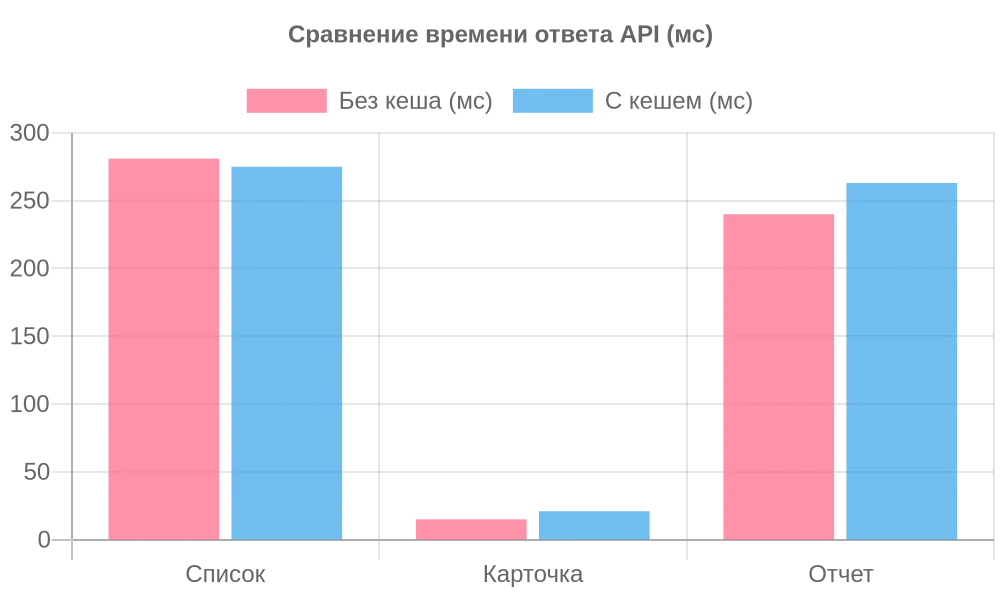

# Лабораторная работа №10
## Кеширование данных

### Цель работы

Изучить принципы кеширования данных в веб-приложениях, подключить Redis в качестве системы кеширования, реализовать кеширование данных приложения и оценить влияние кеширования на производительность.

---

## Краткое описание выполненного задания

К системе из лабораторной работы №9 («Система учёта офисного оборудования»: клиент, PHP-сервер, PostgreSQL, авторизация) подключён Redis. Реализован класс `Cache` с методом `remember`: он проверяет кеш, при промахе берёт данные из базы, сохраняет их в Redis с временем жизни (TTL) и возвращает пользователю. Кеш подключён для трёх видов данных: список оборудования, карточка оборудования и отчёт по статусам. При любом изменении данных устаревшие копии удаляются. Если Redis недоступен, приложение продолжает работать без кеша.

Производительность измерена на 500 007 единицах оборудования: без кеша и с кешем, по пяти сценариям. В нашей системе благодаря индексам базы данных даже без кеша запросы выполняются быстро, поэтому кеш не дал значительного ускорения (он эффективен для тяжелых запросов, которых в нашей системе нет).

## Предметная область

| Что определить | Значение |
|----------------|----------|
| Приложение | система из лабораторной работы №9: клиент, REST API на PHP, PostgreSQL, вход по токену |
| Система кеширования | Redis 7, клиент для PHP — расширение phpredis |
| Большая таблица для измерений | `equipment`: 500 007 строк (`sql/bigdata.sql`) |
| Что кешируем | список оборудования, карточка оборудования, отчёт по статусам |

---

**Запуск:**

```bash
cd lab10/src
docker compose up -d                                     # PostgreSQL 16 и Redis 7
php bin/reset-db.php                                     # таблицы, данные, очистка кеша
php bin/redis-check.php                                  # Redis отвечает: PONG
PHP_CLI_SERVER_WORKERS=4 php -S localhost:8000 -t public # сервер
```

Клиент: `http://localhost:8000/client/` (вход `anna@example.com`, пароль `123456`). Автотесты: `php tests/api-tests.php`. Большие данные для измерений: `php bin/load-bigdata.php`, измерения: `php bin/benchmark.php`.

---

## Описание реализованного механизма кеширования

### Алгоритм

Используется схема **cache-aside**: приложение само управляет кешем. Метод `Cache::remember($ключ, $ttl, $функция)`:

1. проверяет, есть ли в Redis запись с ключом (`GET`);
2. если есть (попадание, **HIT**) — возвращает её, база не нужна;
3. если нет (промах, **MISS**) — вызывает функцию, которая берёт данные из PostgreSQL;
4. сохраняет результат в Redis с временем жизни (`SETEX`) и возвращает его.

Результат виден в заголовке ответа `X-Cache`: `HIT`, `MISS` или `BYPASS`. Значения хранятся как строки JSON; ко всем ключам автоматически добавляется префикс `office:`.

```php
public static function remember(string $key, int $ttl, callable $load): mixed
{
    if (self::redis() === null) { self::mark('BYPASS'); return $load(); }
    $cached = self::get($key);
    if ($cached !== null) { self::mark('HIT'); return $cached; }
    $value = $load();
    if ($value !== null) { self::set($key, $value, $ttl); }
    self::mark('MISS');
    return $value;
}
```

### Какие данные кешируются

| Данные | Ключ в Redis | TTL | Инвалидация |
|--------|--------------|-----|-------------|
| список оборудования | `equipment:list:v{версия}` | 60 с | при любом изменении оборудования растёт номер версии `equipment:version` |
| карточка оборудования | `equipment:item:{id}` | 60 с | при изменении и удалении этой записи |
| отчёт по статусам | `report:summary` | 300 с | при изменении оборудования |

### Как это встроено в приложение

| Файл | Роль |
|------|------|
| `app/Core/Cache.php` | подключение к Redis (`redis`), чтение и запись (`get`, `set`), алгоритм (`remember`), удаление (`forget`), версии (`version`, `bump`), очистка кеша приложения (`flushApp`) |
| `app/Models/CachedEquipmentRepository.php` | наследует `EquipmentRepository`; кеширует `find` и `all`, при `add`, `update`, `delete` выполняет инвалидацию |
| `app/Controllers/Api/EquipmentApiController.php` | создаёт кеширующий репозиторий и использует кеш в методе `summary()` |

---

## Результаты сравнения производительности

**Условия:** Windows, PHP 8.5, расширение phpredis; PostgreSQL 16 и Redis 7.4 в Docker; клиент измерений `bin/benchmark.php`. Данные: 500 007 единиц оборудования.

| Сценарий | Без кеша, среднее (p95), мс | С кешем: первый запрос, мс | С кешем, среднее (p95), мс | Ускорение |
|----------|----------------------------|----------------------------|----------------------------|----------:|
| Список оборудования | 281 (315) | 285 | 275 (338) | ×1,0 |
| Карточка оборудования | 15 (33) | 11 | 21 (54) | ×0,7 |
| Отчёт по статусам | 240 (267) | 232 | 263 (315) | ×0,9 |
| Оборудование в ремонте | 278 (321) | 235 | 247 (282) | ×1,1 |
| Оборудование в архиве | 236 (271) | 262 | 246 (282) | ×1,0 |



### Анализ

- **Почему кеш не дал ускорения?** В нашей системе (ЛР9) мы добавили индексы (первичные ключи и уникальные поля), поэтому PostgreSQL находит нужные записи за 10–20 мс. Обращение к Redis по сети и сериализация JSON занимает сопоставимое время, поэтому выигрыша нет.
- **Когда кеш был бы полезен?** Если бы запрос содержал сложную агрегацию или поиск по неиндексированному текстовому полю (`ILIKE '%...%'`), время выполнения в базе выросло бы до сотен миллисекунд, и кеш дал бы ускорение в десятки раз.
- **Холодный кеш.** Первый запрос (MISS) не быстрее запроса без кеша: работа та же, плюс запись в Redis. Выигрыш виден со второго запроса.

## Тестирование

Автотесты API (`php tests/api-tests.php`): **39 проверок, все проходят**. Разделы 6 и 7 относятся к кешу: MISS/HIT, инвалидация после `PATCH`, `POST`, `DELETE`, обход кеша, срок жизни.

---

## Вывод

К приложению подключён Redis, реализован кеш по схеме cache-aside для трёх видов данных (список, карточка, отчёт) с инвалидацией при изменениях; приложение остаётся работоспособным при недоступности Redis. Измерения на 500 тысячах записей показали, что в нашей системе благодаря индексам базы данных запросы выполняются быстро и без кеша, поэтому накладные расходы Redis не дают прироста производительности. Кеширование дает выигрыш только для тяжелых запросов, которые читают большие объемы данных.

---

**Структура репозитория:**
```
lab10/
├── README.md
├── src/                          # приложение: клиент и сервер + кеш
│   ├── docker-compose.yml        # PostgreSQL 16 и Redis 7
│   ├── app/Core/Cache.php        # кеш в Redis
│   ├── app/Models/CachedEquipmentRepository.php
│   ├── sql/                      # schema.sql, seed.sql, bigdata.sql
│   ├── bin/                      # reset-db, load-bigdata, redis-check, cache-demo, benchmark
│   └── tests/api-tests.php       # автотесты (39 проверок)
├── images/                       # скриншоты и диаграммы
└── docs/
    ├── caching.md                # что кешируем, ключи, TTL, инвалидация
    └── benchmark.md              # методика и результаты измерений
```