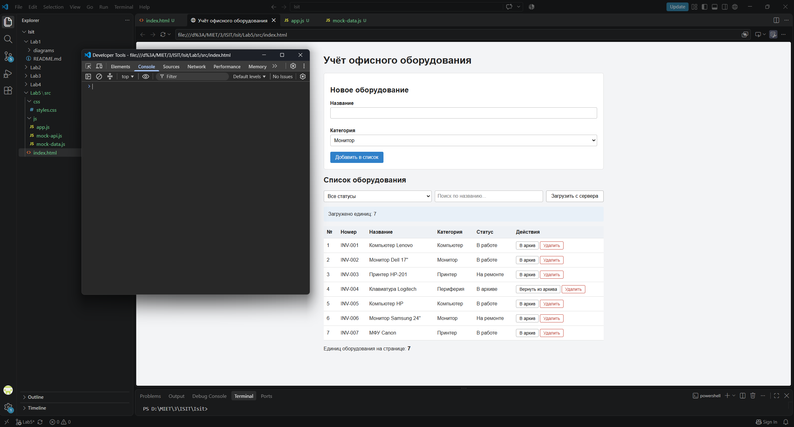
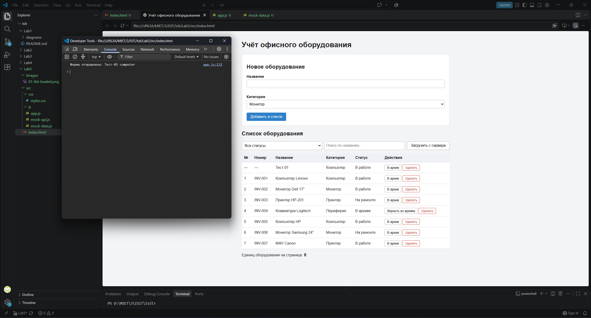
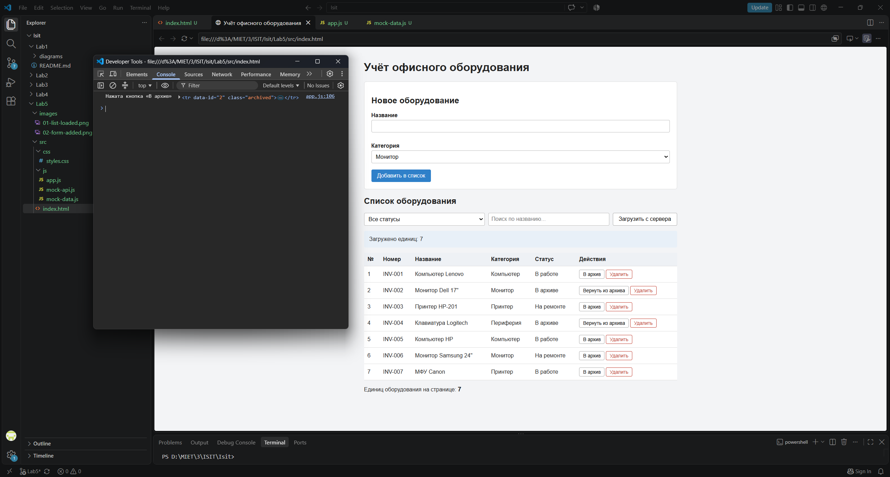
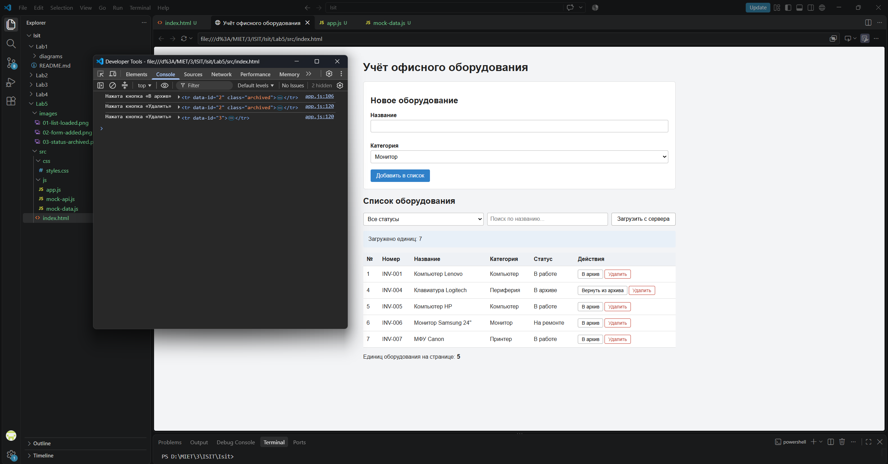
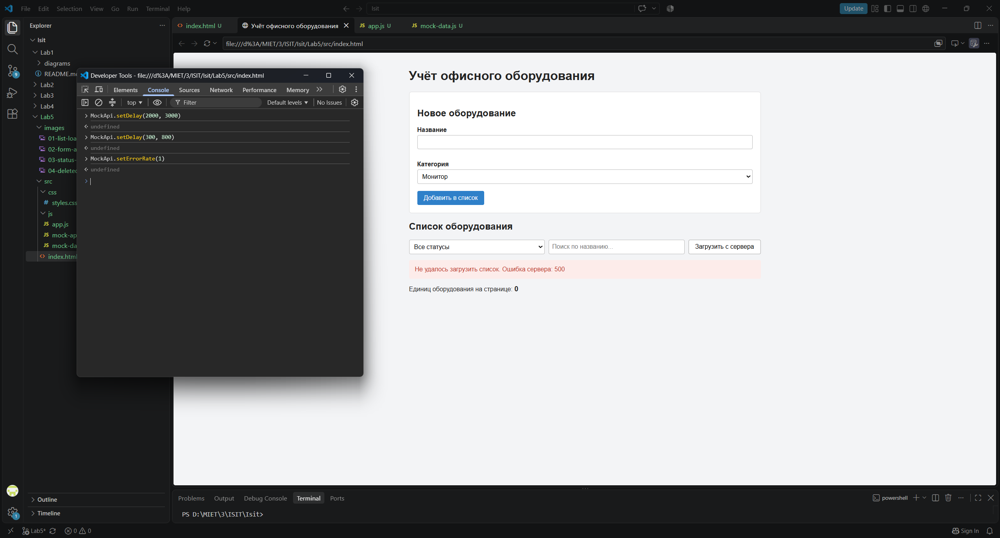

# Лабораторная работа №5
## Реализация клиентской логики

### Цель работы

Изучить основы разработки клиентской части веб-приложений, реализовать обработку пользовательских событий, взаимодействие с сервером посредством асинхронных запросов и динамическое изменение содержимого веб-страницы с использованием JavaScript.

---

## Краткое описание выполненного задания

На основе пользовательского интерфейса системы «Система учёта офисного оборудования» (лабораторная работа №4) реализована клиентская логика на HTML, CSS и чистом JavaScript (без библиотек и фреймворков). Страница показывает список оборудования, позволяет искать и фильтровать его, добавлять новые записи, отправлять в архив и удалять.

Серверной части пока нет, поэтому данные берутся из учебного сервера, который работает в браузере. В `src/js/mock-data.js` описаны массивы с данными (`equipment`, `users`) и таблица `ROUTES` («какой запрос — какие данные возвращает»), а `src/js/mock-api.js` — «движок», который перехватывает запросы `fetch` к адресам `/api/...` и отвечает как настоящий REST API (с задержкой, кодом ответа и JSON).

**Запуск:** открыть файл src/index.html в браузере двойным щелчком. Веб-сервер не требуется.

---

## Описание реализованной клиентской логики

Вся логика находится в файле `src/js/app.js`:

| Блок | Назначение |
|---|---|
| поиск элементов страницы | `document.getElementById(...)` по `id` из `index.html` |
| `showInfo()`, `updateCounter()`, `addCell()` | вспомогательные функции для вывода сообщений, обновления счётчика и создания ячеек |
| `createEquipmentRow()` | создание строки таблицы для одной единицы оборудования |
| `onFormSubmit()`, `onArchiveClick()`, `onDeleteClick()` | обработчики событий |
| `loadEquipment()`, `refreshList()` | запрос к серверу и вывод полученных данных |

Страница работает по схеме «событие → действие → результат на странице»: пользователь выполняет действие, обработчик меняет содержимое страницы, перезагрузки страницы не происходит.



Список загружается автоматически при открытии страницы и повторно по кнопке «Загрузить с сервера».

---

## Описание обработки пользовательских событий

| Событие | Элемент | Что происходит |
|---|---|---|
| `submit` | форма «Новое оборудование» | отмена перезагрузки страницы (`preventDefault`), проверка названия (не короче 3 символов), добавление строки в таблицу, очистка формы |
| `click` | кнопка «Загрузить с сервера» | запрос к серверу и обновление таблицы |
| `change` | список «Все статусы» | запрос с выбранным статусом и обновление таблицы |
| `input` | поле поиска | запрос с введённым текстом и обновление таблицы |
| `click` | кнопка «В архив» / «Вернуть из архива» в строке | оборудование отправляется в архив или возвращается в работу |
| `click` | кнопка «Удалить» в строке | подтверждение и удаление строки со страницы |

Обработчики кнопок в строках подключаются в момент создания строки (`addEventListener` внутри `createEquipmentRow`), потому что строки появляются на странице динамически.

---

## Описание работы с DOM и асинхронными запросами

### Работа с DOM

| Операция | Где в коде | Пример |
|---|---|---|
| создание новых элементов | `createEquipmentRow()`, `addCell()` | `document.createElement('tr')`, `appendChild`, `insertBefore` |
| удаление элементов | `onDeleteClick()` | `row.remove()` |
| изменение текста | `onArchiveClick()`, `showInfo()`, `updateCounter()` | `cell.textContent = 'В архиве'` |
| изменение атрибутов | `createEquipmentRow()`, `onArchiveClick()`, `updateCounter()` | `row.setAttribute('data-id', ...)`, `button.setAttribute('title', ...)`, `table.hidden = true` |
| изменение классов оформления | `createEquipmentRow()`, `onArchiveClick()` | `row.classList.toggle('archived')` |

Весь текст, в том числе введённый пользователем, записывается через `textContent`, поэтому внедрить HTML-код через название оборудования невозможно.

### Асинхронные запросы

Запрос выполняется функцией `loadEquipment()`:

```javascript
const response = await fetch('/api/equipment?status=in_use&q=');
if (!response.ok) {
  throw new Error('Ошибка сервера: ' + response.status);
}
return await response.json();
```

Функция `refreshList()` управляет состояниями страницы:

| Состояние | Что видит пользователь |
|---|---|
| загрузка | сообщение «Загрузка…», кнопка «Загрузить с сервера» заблокирована |
| данные получены | таблица со строками и сообщение «Загружено единиц: N» |
| данных нет | сообщение «Оборудование не найдено», таблица скрыта |
| ошибка | красное сообщение |

### Запросы к API

| Метод | Адрес | Где используется | Ответ |
|---|---|---|---|
| GET | `/api/equipment?status=&q=` | `loadEquipment()`: загрузка, фильтр, поиск (пустые значения означают «без фильтра») | 200, массив оборудования |

---

## Демонстрация работы

### Добавление через форму



### Отправка в архив



### Удаление



### Сообщение об ошибке



---

## Вывод

В результате работы реализована клиентская логика страницы системы учёта офисного оборудования. Освоены обработка пользовательских событий (`click`, `submit`, `change`, `input`), динамическое изменение содержимого страницы средствами DOM (создание и удаление элементов, изменение текста, атрибутов и классов) и получение данных с сервера с помощью асинхронных запросов `fetch` с обработкой ошибок и состояний загрузки. Интерфейс обновляется без перезагрузки страницы. Запросы к серверу выполняются так же, как к настоящему API, поэтому при подключении серверной части в следующих работах код страницы почти не изменится.

**Структура репозитория:**

```
lab5/
├── README.md
├── src/
│   ├── index.html
│   ├── css/
│   │   └── styles.css
│   └── js/
│       ├── mock-data.js
│       ├── mock-api.js
│       └── app.js
└── images/
    ├── 01-list-loaded.png
    ├── 02-form-added.png
    ├── 03-status-archived.png
    ├── 04-deleted.png
    └── 05-error-message.png
```