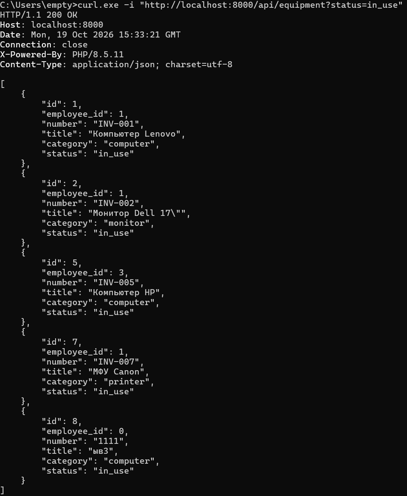
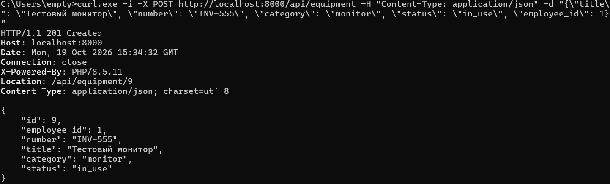
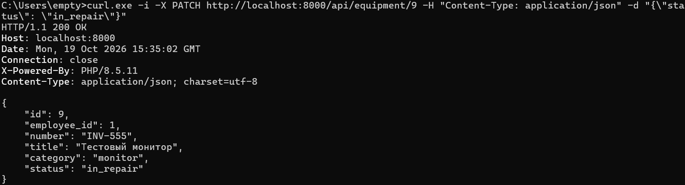
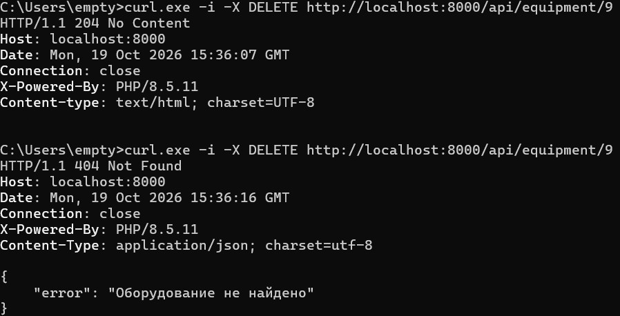
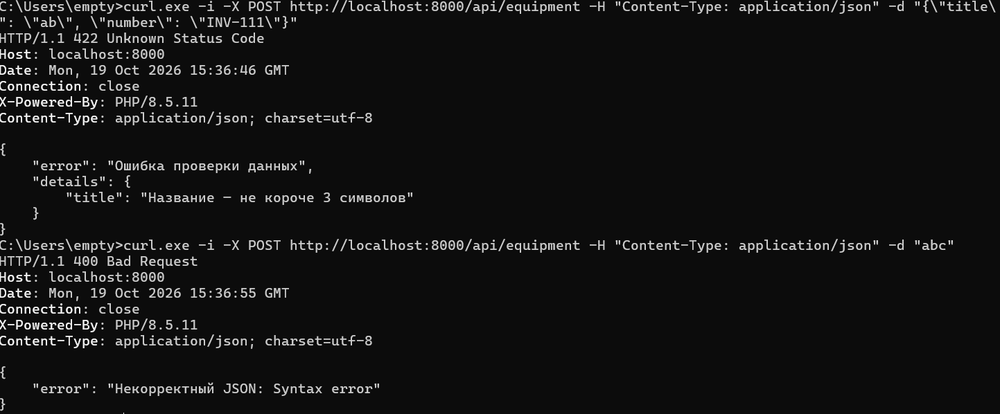
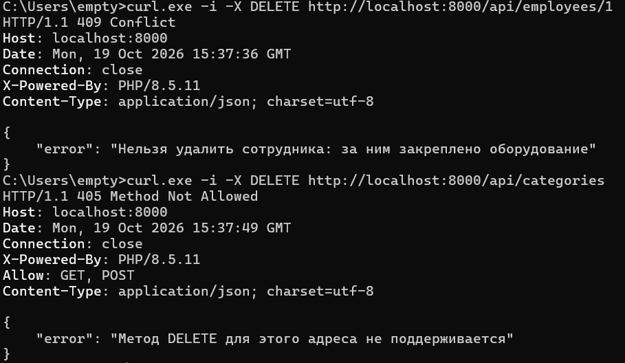

# Результаты тестирования API

Запросы выполнены командой `curl` на локальном сервере (`php -S localhost:8000 -t public`) с исходными данными из `storage/`. Скриншоты — в папке `images/`.

## Оборудование

| № | Запрос | Ожидаемый код | Получен код | Комментарий |
|---|--------|---------------|-------------|-------------|
| 1 | `GET /api/equipment` | 200 | 200 | массив из 8 единиц оборудования |
| 2 | `GET /api/equipment?status=in_use` | 200 | 200 | 4 единицы в работе |
| 3 | `GET /api/equipment/3` | 200 | 200 | объект «Принтер HP-201» |
| 4 | `POST /api/equipment` корректное тело | 201 | 201 | заголовок `Location: /api/equipment/9` |
| 5 | `PATCH /api/equipment/9` `{"status":"in_repair"}` | 200 | 200 | статус изменён, остальные поля прежние |
| 6 | `DELETE /api/equipment/9` | 204 | 204 | тела нет |
| 7 | `DELETE /api/equipment/9` повторно | 404 | 404 | `{"error": "Оборудование не найдено"}` |
| 8 | `GET /api/equipment/999` | 404 | 404 | |
| 9 | `POST /api/equipment` `{"title":"ab"}` | 422 | 422 | ошибка валидации (название < 3 символов) |
| 10 | `POST /api/equipment` тело `abc` | 400 | 400 | не JSON |

## Сотрудники

| № | Запрос | Ожидаемый код | Получен код | Комментарий |
|---|--------|---------------|-------------|-------------|
| 11 | `GET /api/employees` | 200 | 200 | 3 сотрудника |
| 12 | `GET /api/employees/2` | 200 | 200 | |
| 13 | `GET /api/employees/1/equipment` | 200 | 200 | оборудование сотрудника 1 |
| 14 | `POST /api/employees` корректное тело | 201 | 201 | `Location: /api/employees/4` |
| 15 | `PATCH /api/employees/4` `{"position":"Ведущий инженер"}` | 200 | 200 | |
| 16 | `DELETE /api/employees/1` | 409 | 409 | за сотрудником есть оборудование |
| 17 | `DELETE /api/employees/4` | 204 | 204 | сотрудник без оборудования |
| 18 | `GET /api/employees/99` | 404 | 404 | |
| 19 | `POST /api/employees` `{"name":"А"}` | 422 | 422 | ошибка валидации |

## Категории

| № | Запрос | Ожидаемый код | Получен код | Комментарий |
|---|--------|---------------|-------------|-------------|
| 20 | `GET /api/categories` | 200 | 200 | 4 категории |
| 21 | `GET /api/categories/2` | 200 | 200 | |
| 22 | `POST /api/categories` корректное тело | 201 | 201 | |
| 23 | `PUT /api/categories/1` `{"name":"bad"}` | 422 | 422 | `errors.name` |
| 24 | `DELETE /api/categories` | 405 | 405 | `Allow: GET, POST` |
| 25 | `DELETE /api/categories/99` | 404 | 404 | |

## Общие

| № | Запрос | Ожидаемый код | Получен код | Комментарий |
|---|--------|---------------|-------------|-------------|
| 26 | `GET /api/nothing` | 404 | 404 | JSON-ответ, а не HTML-страница |
| 27 | `GET /equipment` | 200 | 200 | сайт из лабораторной работы №6 продолжает работать |

Примечание. Встроенный сервер PHP выводит в первой строке ответа для кода 422 слова «Unknown Status Code»: это особенность его таблицы названий кодов, сам код 422 и тело ответа верные.

## Скриншоты

