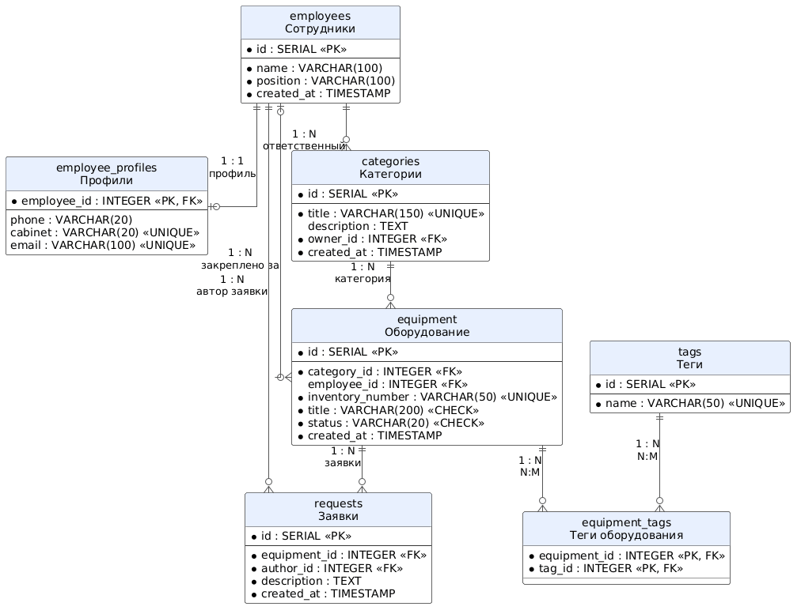
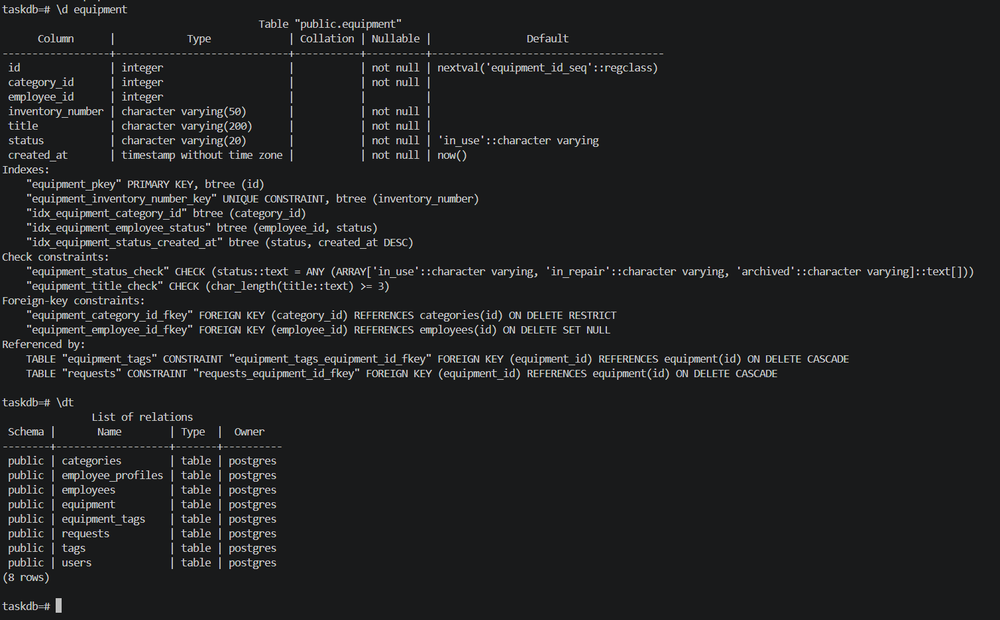
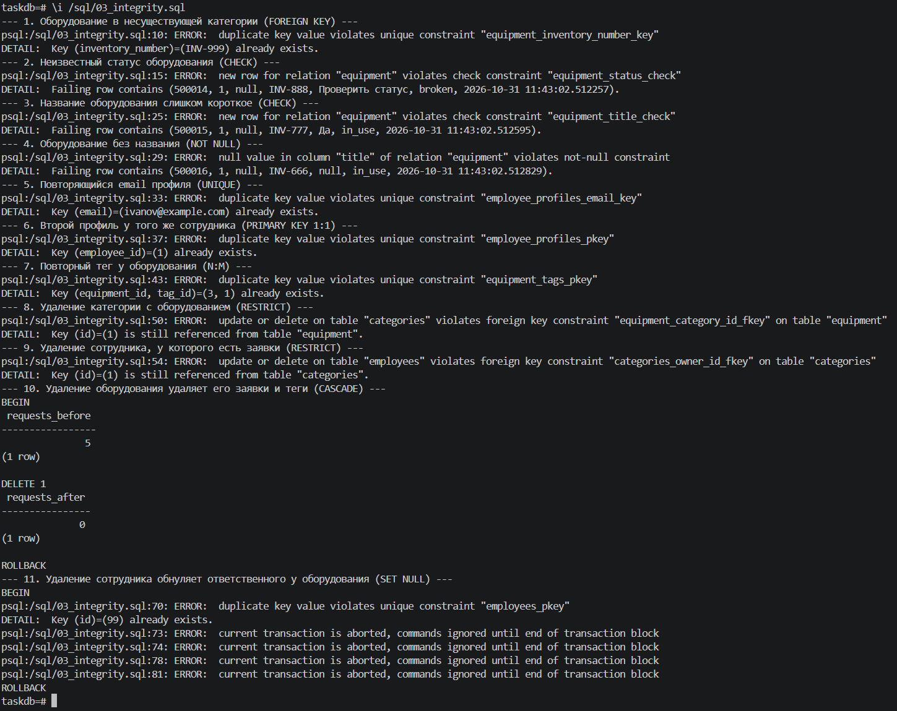
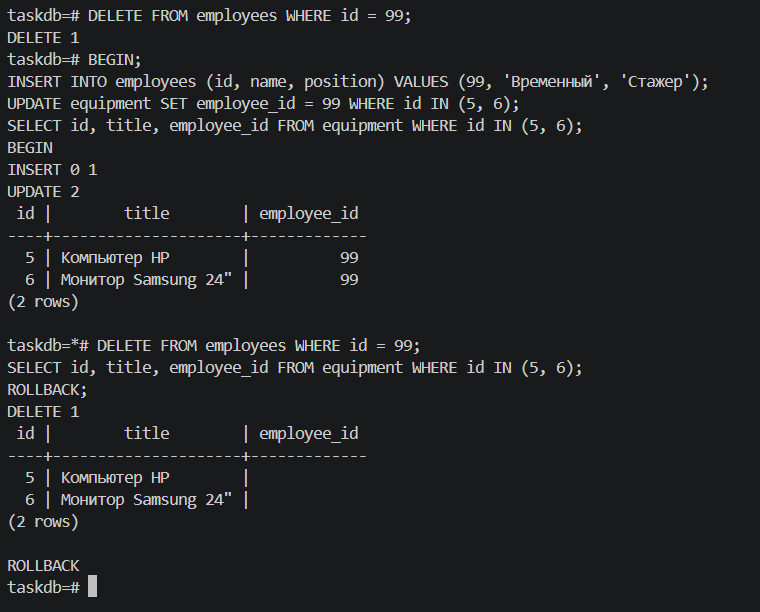
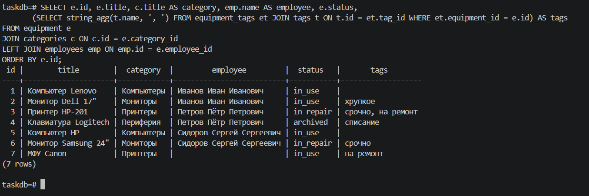
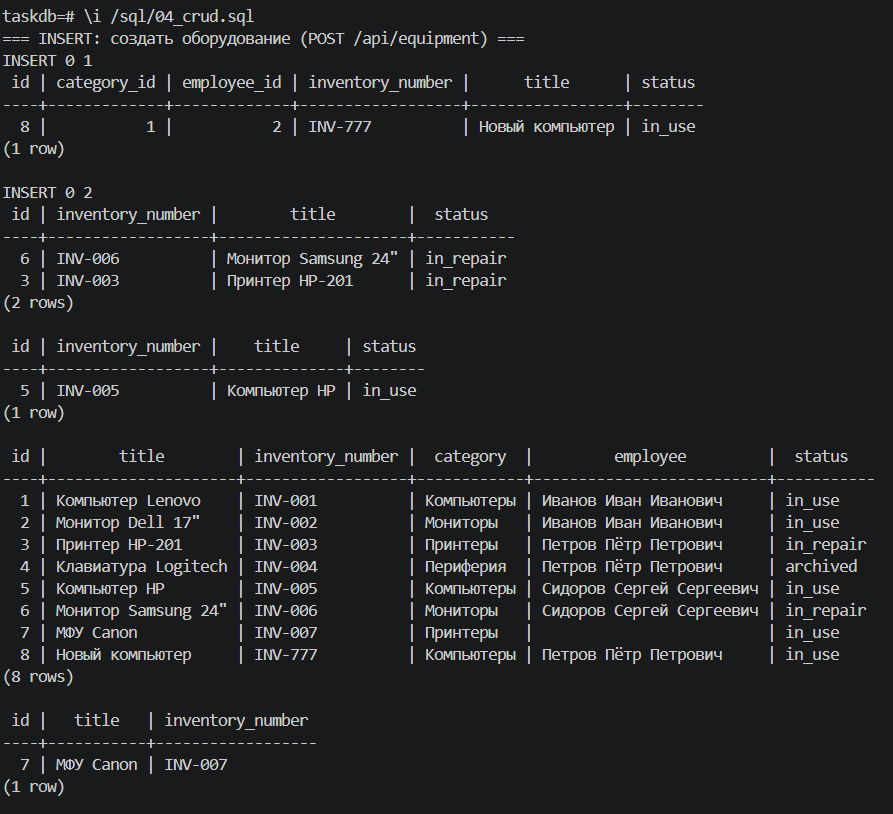
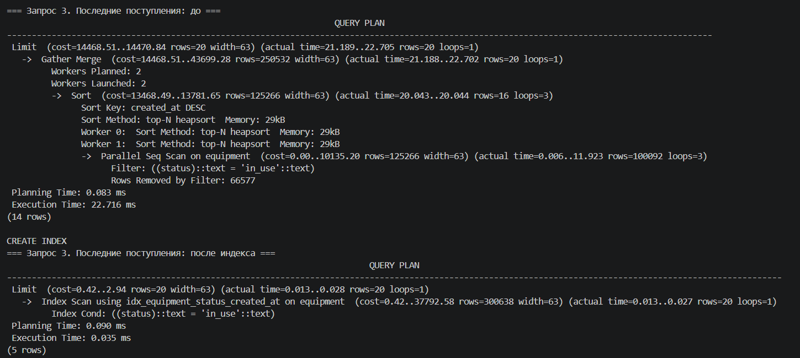
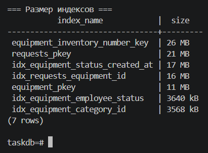

# Лабораторная работа №8
## Проектирование и реализация базы данных

### Цель работы

Изучить основы проектирования реляционных баз данных, разработать структуру базы данных PostgreSQL, реализовать связи между сущностями, выполнить основные операции по работе с данными и освоить базовые методы оптимизации SQL-запросов.

---

## Краткое описание выполненного задания

Для системы «Система учёта офисного оборудования» (лабораторные работы №1–7) спроектирована и реализована база данных PostgreSQL 16: 7 таблиц, связи «один к одному», «один ко многим» и «многие ко многим», ограничения целостности (`PRIMARY KEY`, `FOREIGN KEY`, `NOT NULL`, `UNIQUE`, `CHECK`, `DEFAULT`). Подготовлены SQL-скрипты создания таблиц, тестовых данных, проверки ссылочной целостности и CRUD-операций. На 500 000 единиц оборудования и 1 000 000 заявок проанализированы планы четырёх частых запросов (`EXPLAIN ANALYZE`); после добавления индексов они ускорились в десятки и сотни раз.

## Предметная область

| Что определить | Значение |
|----------------|----------|
| Основная сущность | оборудование (`equipment`) |
| Связанная сущность | категория (`categories`) |
| Третья сущность | сотрудник (`employees`) |
| Дополнительные сущности | профиль сотрудника (`employee_profiles`), заявка на ремонт (`requests`), тег (`tags`) |
| Связь 1:1 | сотрудник — профиль |
| Связи 1:N | категория — оборудование, сотрудник — оборудование, сотрудник — категории, оборудование — заявки |
| Связь N:M | оборудование — теги (через `equipment_tags`) |

Таблицы `equipment`, `categories` и `employees` повторяют ресурсы REST API из лабораторной работы №7 (те же поля и исходные данные), поэтому в следующей работе API можно перевести с JSON-файлов на базу, не меняя формат ответов.

---

**Запуск** (нужен Docker; без него — установленный PostgreSQL 16 и клиент psql, pgAdmin или DBeaver):

```bash
cd lab8
docker compose up -d                                  # сервер PostgreSQL 16, база taskdb
docker compose exec db psql -U postgres -d taskdb    # консоль psql
```

Внутри `psql` скрипты выполняются по порядку:

```sql
\i /sql/01_schema.sql        -- таблицы и ограничения
\i /sql/02_seed.sql          -- исходные данные
\i /sql/03_integrity.sql     -- проверка ограничений и связей
\i /sql/04_crud.sql          -- CRUD-операции
\i /sql/05_test_data.sql     -- 500 000 единиц оборудования для проверки производительности
\i /sql/06_optimization.sql  -- EXPLAIN ANALYZE до и после индексов
```

Параметры подключения для pgAdmin/DBeaver: хост `localhost`, порт `5432`, база `taskdb`, пользователь `postgres`, пароль `secret`.

---

## Структура базы данных

### ER-диаграмма



**Исходник:** [`diagrams/src/er.puml`](./diagrams/src/er.puml)

### Таблицы

Полный SQL: [`sql/01_schema.sql`](./sql/01_schema.sql).

**employees** — сотрудники

| Поле | Тип | Ограничения | Описание |
|------|-----|-------------|----------|
| `id` | `SERIAL` | `PRIMARY KEY` | номер сотрудника |
| `name` | `VARCHAR(100)` | `NOT NULL` | ФИО |
| `position` | `VARCHAR(100)` | `NOT NULL`, `DEFAULT 'Сотрудник'` | должность |
| `created_at` | `TIMESTAMP` | `NOT NULL`, `DEFAULT NOW()` | дата добавления |

**employee_profiles** — профиль сотрудника (связь 1:1)

| Поле | Тип | Ограничения | Описание |
|------|-----|-------------|----------|
| `employee_id` | `INTEGER` | `PRIMARY KEY`, `REFERENCES employees ON DELETE CASCADE` | сотрудник; одновременно первичный и внешний ключ |
| `phone` | `VARCHAR(20)` | | телефон |
| `cabinet` | `VARCHAR(20)` | `UNIQUE` | номер кабинета |
| `email` | `VARCHAR(100)` | `UNIQUE` | рабочая почта |

**categories** — категории оборудования

| Поле | Тип | Ограничения | Описание |
|------|-----|-------------|----------|
| `id` | `SERIAL` | `PRIMARY KEY` | номер категории |
| `title` | `VARCHAR(150)` | `NOT NULL`, `UNIQUE` | название |
| `description` | `TEXT` | | описание |
| `owner_id` | `INTEGER` | `NOT NULL`, `REFERENCES employees ON DELETE RESTRICT` | ответственный |
| `created_at` | `TIMESTAMP` | `NOT NULL`, `DEFAULT NOW()` | дата создания |

**equipment** — оборудование (основная сущность)

| Поле | Тип | Ограничения | Описание |
|------|-----|-------------|----------|
| `id` | `SERIAL` | `PRIMARY KEY` | номер оборудования |
| `category_id` | `INTEGER` | `NOT NULL`, `REFERENCES categories ON DELETE RESTRICT` | категория |
| `employee_id` | `INTEGER` | `REFERENCES employees ON DELETE SET NULL` | ответственный, может отсутствовать |
| `inventory_number` | `VARCHAR(50)` | `NOT NULL`, `UNIQUE` | инвентарный номер |
| `title` | `VARCHAR(200)` | `NOT NULL`, `CHECK (char_length(title) >= 3)` | название, не короче 3 символов |
| `status` | `VARCHAR(20)` | `NOT NULL`, `DEFAULT 'in_use'`, `CHECK` | `in_use`, `in_repair`, `archived` |
| `created_at` | `TIMESTAMP` | `NOT NULL`, `DEFAULT NOW()` | дата постановки на учёт |

**requests** — заявки на ремонт

| Поле | Тип | Ограничения | Описание |
|------|-----|-------------|----------|
| `id` | `SERIAL` | `PRIMARY KEY` | номер заявки |
| `equipment_id` | `INTEGER` | `NOT NULL`, `REFERENCES equipment ON DELETE CASCADE` | оборудование |
| `author_id` | `INTEGER` | `NOT NULL`, `REFERENCES employees ON DELETE RESTRICT` | автор заявки |
| `description` | `TEXT` | `NOT NULL` | текст заявки |
| `created_at` | `TIMESTAMP` | `NOT NULL`, `DEFAULT NOW()` | дата |

**tags** и **equipment_tags** — теги и связь «оборудование — тег» (N:M)

| Таблица | Поле | Тип | Ограничения |
|---------|------|-----|-------------|
| `tags` | `id` | `SERIAL` | `PRIMARY KEY` |
| `tags` | `name` | `VARCHAR(50)` | `NOT NULL`, `UNIQUE` |
| `equipment_tags` | `equipment_id` | `INTEGER` | `REFERENCES equipment ON DELETE CASCADE` |
| `equipment_tags` | `tag_id` | `INTEGER` | `REFERENCES tags ON DELETE CASCADE` |
| `equipment_tags` | | | `PRIMARY KEY (equipment_id, tag_id)` — пара не повторяется |

Структура соответствует трём правилам нормализации: в каждой ячейке одно значение (теги вынесены в отдельную таблицу, а не записаны через запятую), каждая таблица описывает одну сущность, данные сотрудника хранятся один раз в `employees`, а в оборудовании и заявках только ссылка на него.



---

## Связи между сущностями

| Связь | Тип | Как реализована | При удалении «главной» строки |
|-------|-----|-----------------|-------------------------------|
| сотрудник — профиль | 1:1 | `employee_profiles.employee_id` — первичный и внешний ключ одновременно | профиль удаляется (`CASCADE`) |
| сотрудник — категории | 1:N | `categories.owner_id` | запрет, пока у сотрудника есть категории (`RESTRICT`) |
| категория — оборудование | 1:N | `equipment.category_id` | запрет, пока в категории есть оборудование (`RESTRICT`) |
| сотрудник — оборудование | 1:N | `equipment.employee_id`, может быть `NULL` | оборудование остаётся без ответственного (`SET NULL`) |
| оборудование — заявки | 1:N | `requests.equipment_id` | заявки удаляются (`CASCADE`) |
| сотрудник — заявки | 1:N | `requests.author_id` | запрет (`RESTRICT`): история заявок не теряется |
| оборудование — теги | N:M | связующая таблица `equipment_tags` с составным первичным ключом | строки связи удаляются (`CASCADE`) |

### Проверка ссылочной целостности

Скрипт [`sql/03_integrity.sql`](./sql/03_integrity.sql) пытается нарушить каждое правило. Все некорректные запросы отклонены базой, а каскадное удаление и `SET NULL` сработали как задумано (проверки выполнены внутри транзакции с `ROLLBACK`, данные не изменились).




---

## Примеры SQL-запросов (CRUD)

Все запросы: [`sql/04_crud.sql`](./sql/04_crud.sql). Для каждого указан адрес REST API из лабораторной работы №7, который будет его выполнять.

| Операция | SQL | REST API |
|----------|-----|----------|
| Create | `INSERT INTO equipment (...) VALUES (...) RETURNING ...` | `POST /api/equipment` |
| Read (список) | `SELECT ... FROM equipment WHERE status = 'in_repair' ORDER BY title` | `GET /api/equipment?status=in_repair` |
| Read (одна) | `SELECT ... FROM equipment WHERE id = 5` | `GET /api/equipment/5` |
| Update | `UPDATE equipment SET status = 'in_repair' WHERE id = ... RETURNING ...` | `PATCH /api/equipment/{id}` |
| Delete | `DELETE FROM equipment WHERE id = ... RETURNING ...` | `DELETE /api/equipment/{id}` |

**Создание оборудования.** `RETURNING` сразу возвращает созданную строку, а `\gset` сохраняет её номер в переменную psql `:eq_id` для следующих запросов:

```sql
INSERT INTO equipment (category_id, employee_id, inventory_number, title, status)
VALUES (1, 2, 'INV-777', 'Новый компьютер', 'in_use')
RETURNING id AS eq_id, title, status \gset
```

**Оборудование с категорией и сотрудником** (`LEFT JOIN`, потому что у части оборудования ответственного нет):

```sql
SELECT e.id, e.title, c.title AS category, emp.name AS employee, e.status
FROM equipment e
JOIN categories c ON c.id = e.category_id
LEFT JOIN employees emp ON emp.id = e.employee_id
ORDER BY e.id;
```

**Теги оборудования одной строкой** (связь N:M):

```sql
SELECT e.id, e.title, string_agg(t.name, ', ' ORDER BY t.name) AS tags
FROM equipment e
JOIN equipment_tags et ON et.equipment_id = e.id
JOIN tags t            ON t.id = et.tag_id
GROUP BY e.id, e.title
ORDER BY e.id;
```

**Отчёт: сколько оборудования закреплено за сотрудником и сколько в ремонте:**

```sql
SELECT emp.name,
       COUNT(e.id) AS total_equipment,
       COUNT(e.id) FILTER (WHERE e.status = 'in_repair') AS in_repair_count
FROM employees emp
LEFT JOIN equipment e ON e.employee_id = emp.id
GROUP BY emp.id, emp.name
ORDER BY emp.id;
```

#### SELECT: JOIN, теги (N:M), отчёт с GROUP BY


#### INSERT, UPDATE, DELETE


---

## Результаты оптимизации запросов

Для проверки скорости скрипт [`sql/05_test_data.sql`](./sql/05_test_data.sql) добавляет 1000 категорий, 200 сотрудников, 500 000 единиц оборудования и 1 000 000 заявок. Затем [`sql/06_optimization.sql`](./sql/06_optimization.sql) для каждого частого запроса выполняет `EXPLAIN ANALYZE` без индекса, создаёт индекс и повторяет `EXPLAIN ANALYZE`.

| № | Запрос | Индекс | План до | План после | До, мс | После, мс | Ускорение |
|---|--------|--------|---------|------------|-------:|----------:|----------:|
| 1 | оборудование категории (`WHERE category_id = 500`) | `equipment (category_id)` | Parallel Seq Scan | Bitmap Index Scan | 14,9 | 0,56 | ×27 |
| 2 | ремонт у сотрудника (`employee_id` + `status`) | `equipment (employee_id, status)` | Parallel Seq Scan | Bitmap Index Scan | 16,1 | 0,82 | ×20 |
| 3 | последние поступления (`ORDER BY created_at DESC LIMIT 20`) | `equipment (status, created_at DESC)` | Seq Scan + Sort | Index Scan, без сортировки | 22,5 | 0,04 | ×562 |
| 4 | заявки на оборудование | `requests (equipment_id)` | Parallel Seq Scan | Index Scan | 14,9 | 0,10 | ×149 |

Наблюдения:

- PostgreSQL не создаёт индексы для внешних ключей автоматически, поэтому запросы 1 и 4 до оптимизации перебирали всю таблицу (в запросе 1 каждый из трёх параллельных процессов прочитал и отбросил около 166 тысяч строк, в запросе 4 — по 333 тысячи);
- в запросе 3 индекс `(status, created_at DESC)` хранит строки уже отсортированными, и из плана исчез шаг `Sort`: база читает первые 20 записей и останавливается;
- индекс не помогает, если запрос читает большую часть таблицы (условие `status = 'in_use'`, которому подходит 60% строк) или ищет подстроку `ILIKE '%...%'`: планировщик всё равно выбирает `Seq Scan`;
- у индексов есть цена: они занимают место на диске и замедляют вставку.

#### Запрос 3 до и после индекса


#### Цена индексов


---

## Вывод

В результате работы спроектирована и реализована реляционная база данных PostgreSQL для системы учёта офисного оборудования: 7 таблиц, связи всех трёх типов (1:1, 1:N и N:M) и ограничения целостности. Правила, которые в лабораторной работе №7 проверял PHP-код (допустимые статусы, длина названия, существование категории, запрет удалить категорию с оборудованием), теперь дополнительно проверяет сама база, и их невозможно обойти из любой программы: это подтверждено скриптом `03_integrity.sql`. CRUD-запросы соответствуют методам REST API и будут использованы при подключении базы к серверной части. Анализ планов `EXPLAIN ANALYZE` на 500 000 единиц оборудования показал, что индексы на внешние ключи и на столбцы фильтрации и сортировки ускоряют частые запросы в десятки раз, но не помогают запросам, читающим большую часть таблицы, и замедляют запись, поэтому их нужно создавать осознанно и проверять планом выполнения.

---

**Структура репозитория:**
```
lab8/
├── README.md
├── docker-compose.yml        # PostgreSQL 16 для запуска скриптов
├── sql/
│   ├── 01_schema.sql         # создание таблиц и ограничений
│   ├── 02_seed.sql           # исходные данные
│   ├── 03_integrity.sql      # проверка ограничений и ссылочной целостности
│   ├── 04_crud.sql           # CRUD-операции
│   ├── 05_test_data.sql      # большой объём данных для оптимизации
│   └── 06_optimization.sql   # EXPLAIN ANALYZE до и после индексов
├── diagrams/
│   ├── images/er.png         # ER-диаграмма
│   └── src/er.puml           # исходник ER-диаграммы (PlantUML)
├── images/                   # скриншоты выполнения скриптов
└── docs/
    └── optimization.md       # полные планы выполнения и разбор (опционально)
```