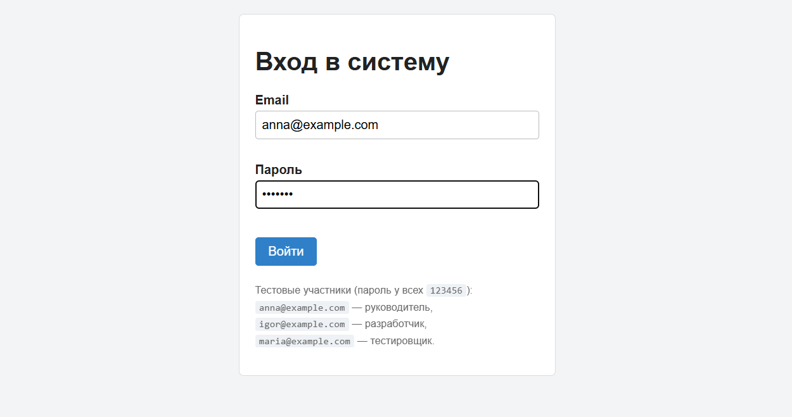
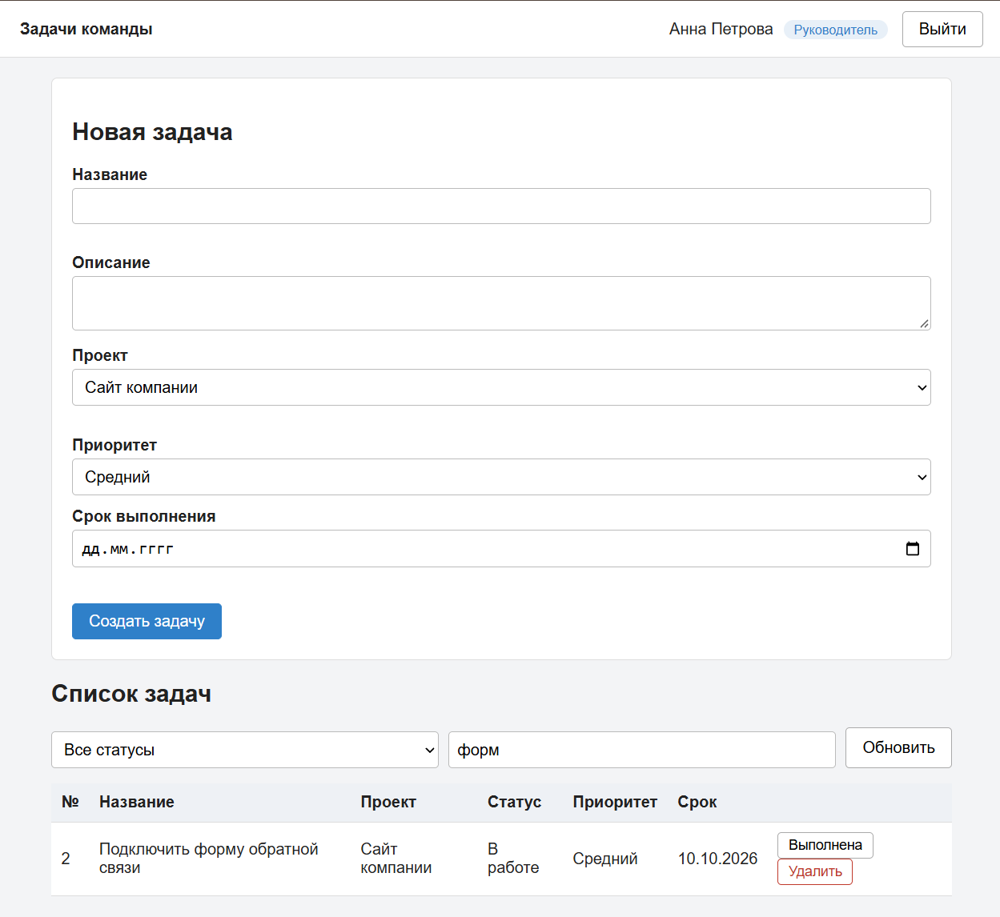
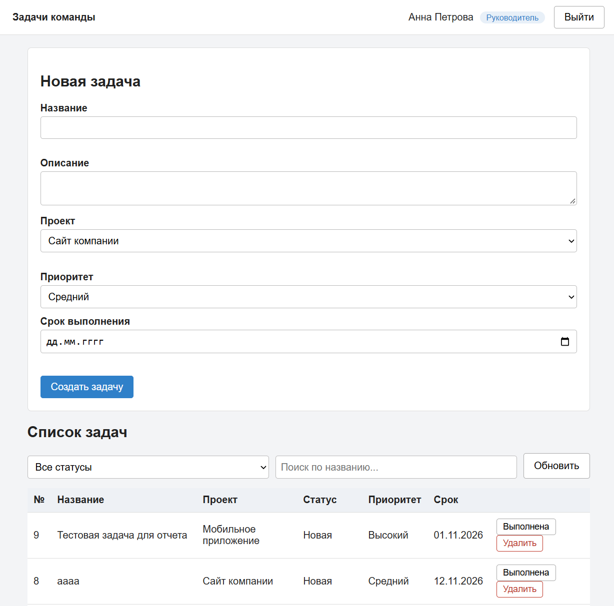
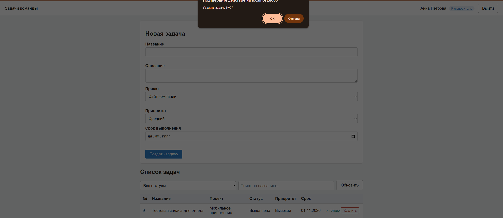
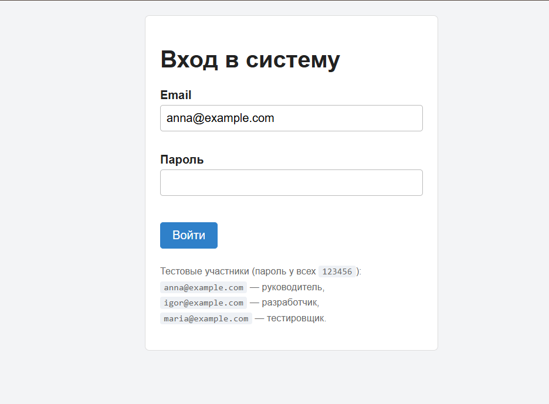
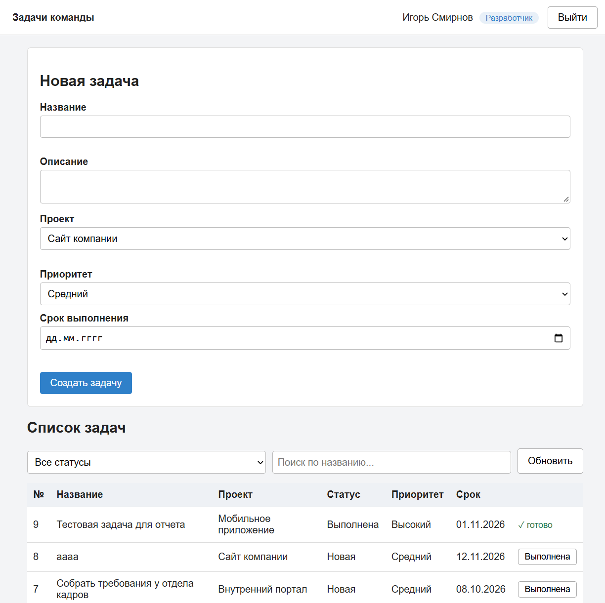
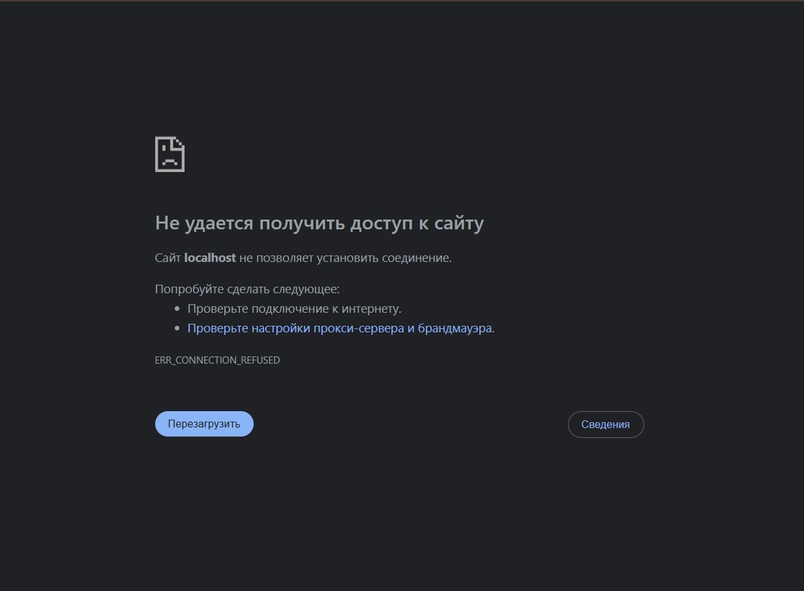
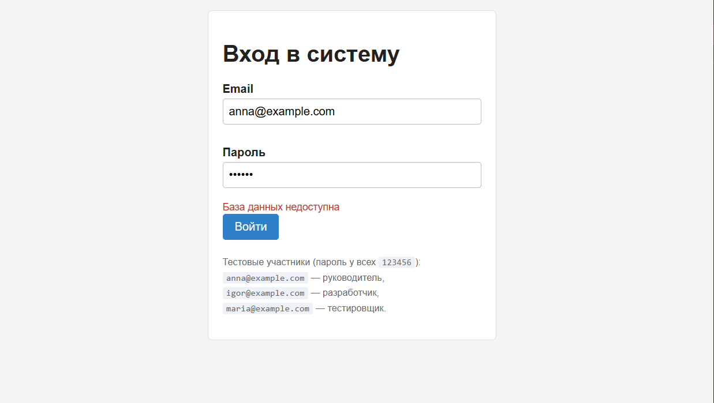

# Комплексное тестирование

Тестирование проводилось на трёх уровнях: автоматические тесты API (сервер), сквозные сценарии в браузере (клиент вместе с сервером) и проверки безопасности. Сервер: PHP 8.2, `php -S localhost:8000 -t public`; база данных: PostgreSQL 16 в Docker; браузер: Google Chrome. Скриншоты — в папке `images/`.

## 1. Автоматические тесты API

Файл [`src/tests/api-tests.php`](../src/tests/api-tests.php). Тесты проверяют коды и содержимое ответов.

**Результат: 61 проверка, 61 прошла, 0 не прошло.**

| Раздел | Проверок | Что проверяется |
|--------|---------:|-----------------|
| 1. Вход в систему | 11 | успешный вход, токен из 64 символов, отсутствие хеша пароля в ответе, 401 для неверного пароля, 422 для пустых полей |
| 2. Защита адресов API | 9 | 401 без токена и с неверным токеном, 200 с токеном, `/api/auth/me`, 404 для несуществующего адреса, 405 с заголовком `Allow` |
| 3. Роли и права | 8 | сотрудник не удаляет оборудование (403), видит список; руководитель удаляет (204) |
| 4. Оборудование: полный цикл | 16 | создание (201), поиск, `PATCH` одного поля, 422 с ошибками, удаление (204), повторное удаление (404) |
| 5. Справочники | 6 | создание сотрудника, 409 для занятой почты, 422 для слабого пароля |
| 6. Сессия и срок действия | 4 | токен работает до выхода, `logout` (204), после выхода 401, токен с истёкшим сроком (401) |
| 7. Дополнительные проверки | 7 | SQL-инъекция в поиске не срабатывает, вход с почтой в другом регистре |

## 2. Сквозные сценарии в браузере

Открыть `http://localhost:8000/client/`, перед сценариями очистить хранилище браузера (`localStorage.clear()` в консоли), открыть DevTools (F12) на вкладке Network.

| № | Сценарий | Шаги | Ожидаемый результат | Результат |
|---|----------|------|---------------------|-----------|
| **Вход и выход** | | | | |
| A1 | Успешный вход руководителем | нажать «Войти» (`anna@example.com` / `123456`) | открывается список: в шапке «Анна Петрова» и «Руководитель», 4 единицы оборудования, в Network `POST /api/auth/login` — 200 | пройден |
| A2 | Неверный пароль | ввести пароль `000000`, «Войти» | под формой «Неверный email или пароль», экран входа остаётся, в Network — 401 | пройден |
| A3 | Проверка на клиенте | ввести email `abc` и пароль `123` | ошибки у обоих полей; запрос в Network не отправляется | пройден |
| A4 | Выход | нажать «Выйти» | экран входа; в `localStorage` нет `token`; прежний токен на сервере даёт 401 | пройден |
| A5 | Сессия сохраняется | войти, обновить страницу (F5) | снова список без повторного входа; в Network `GET /api/auth/me` — 200 | пройден |
| A6 | Сессия истекла | войти, в консоли `localStorage.setItem('token','bad')`, нажать «Обновить» | экран входа с сообщением «Сессия истекла. Войдите снова.» | пройден |
| **Работа со списком** | | | | |
| B1 | Список оборудования | после входа посмотреть таблицу | видны 4 единицы оборудования (Компьютер, Монитор, Принтер, Архивный) | пройден |
| B2 | Обновление списка | нажать кнопку «Обновить» | таблица мигает и данные перезагружаются | пройден |
| **Оборудование** | | | | |
| C1 | Создание оборудования | заполнить название «МФУ Canon», инв. номер «INV-005», выбрать «Принтеры», нажать «Добавить» | новая запись появляется в таблице; в Network `POST /api/equipment` — 201 | пройден |
| C2 | Проверка пустых полей | оставить название пустым, нажать «Добавить» | под полем «Название» появляется ошибка «Введите название» | пройден |
| C3 | Ошибка сервера (422) | в DevTools → Elements изменить `value` у `<option>` категории на `999`, «Добавить» | под списком категорий появляется «Ошибка проверки данных» | пройден |
| C4 | Защита от XSS | название `<b>Тест</b>` | в таблице теги выводятся как текст, жирный шрифт не применяется | пройден |
| C5 | Удаление | «Удалить» → подтвердить | строка исчезает; в Network `DELETE` — 204 | пройден |
| **Роли** | | | | |
| D1 | Интерфейс сотрудника | войти как `igor@example.com` | в шапке «Сотрудник»; кнопок «Удалить» нет | пройден |
| D2 | Запрет на сервере | войти как сотрудник, в консоли `fetch('/api/equipment/1', {method:'DELETE', headers:{Authorization:'Bearer '+getToken()}}).then(r=>console.log(r.status))` | выводится `403`: скрытая кнопка — не защита, запрещает сервер | пройден |
| **Устойчивость** | | | | |
| E1 | Нет связи с сервером | DevTools → Network → Offline, «Обновить» | сообщение «Нет связи с сервером. Проверьте подключение и повторите.» | пройден |
| E2 | Ошибки JavaScript | пройти все сценарии с открытой консолью | исключений JavaScript нет | пройден |
| E3 | База данных недоступна | войти, остановить PostgreSQL (`docker compose stop db`), нажать «Обновить» | над таблицей «Не удалось загрузить список: База данных недоступна» (ответ API 503); после `docker compose start db` и «Обновить» список снова загружается | пройден |

### Скриншоты (файлы из папки `images/`)

#### A1. Вход

#### B2. Поиск и список

#### C1. Созданная задача

#### C6. Удаление

#### A4. Выход

#### D1. Интерфейс разработчика (нет кнопок «Удалить»)

#### E1. Сервер выключен

#### E3. База данных недоступна

## 3. Проверки безопасности

| Проверка | Как проверялась | Результат |
|----------|-----------------|-----------|
| Пароли не хранятся открытым текстом | `SELECT ... FROM employees` в psql: в таблице только `password_hash` (bcrypt) | пройдена |
| Токен не хранится на сервере | `SELECT ... FROM auth_tokens`: хеш токена (SHA-256), номер участника, срок | пройдена |
| SQL-инъекция в поиске не срабатывает | автотест: запрос `?q=' OR 1=1 --` возвращает 200 и пустой список | пройдена |
| Хеш пароля не уходит клиенту | автотесты: нет слов `password_hash` и `$2y$` в ответах входа, `/api/auth/me` | пройдена |
| Не раскрывается, существует ли почта | одинаковое сообщение «Неверный email или пароль» для неверной почты и пароля | пройдена |
| Защита API на сервере, а не в интерфейсе | прямые запросы без токена (401) и с токеном сотрудника (403), в обход кнопок | пройдена |
| Токен нельзя использовать после выхода и по истечении срока | автотесты, раздел 6; сценарий A4 | пройдена |
| Данные пользователя не вставляются в HTML как код | сценарий C4 | пройдена |

## 4. Что пришлось согласовать между клиентом и сервером

| Что не совпадало | Как проявлялось | Решение |
|------------------|-----------------|---------|
| Сервер требует `category_id`, в форме проекта нет | при создании оборудования ответ 422 | в форму добавлен список категорий, номер отправляется числом |
| Имя поля: клиент ожидал `dueDate`, сервер требует `inventory_number` | в таблице не было инвентарного номера | клиент использует `inventory_number` |
| Формат ошибок: клиент ждал `fields`, сервер присылает `errors` | пользователь видел только общий текст | `error.fields = data.errors`, сообщения показываются под полями |
| Сортировка: клиент просил `_sort=id&_order=desc`, сервер понимает `sort=-id` | новые записи оказывались внизу | клиент отправляет `sort=-id` |
| Ответ 401 в середине работы | над пустой таблицей красное «Требуется авторизация» | клиент возвращает к форме входа с сообщением «Сессия истекла» |
| Ответ 403 для не-руководителя | кнопка «Удалить» вела к ошибке | кнопка показывается только руководителю; сервер запрещает в любом случае |

## Итог

| Уровень | Проверок | Прошло |
|---------|---------:|-------:|
| Автотесты API | 61 | 61 |
| Сквозные сценарии в браузере | 15 | 15 |
| Проверки безопасности | 8 | 8 |

Все запланированные проверки пройдены.